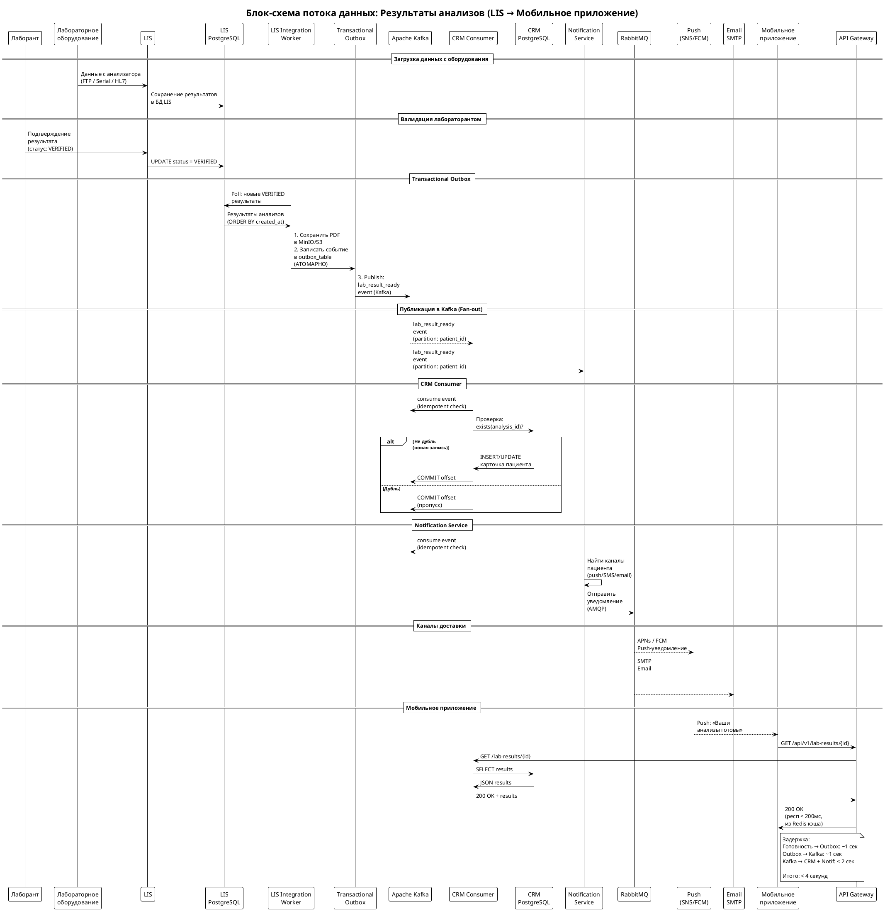

# Задание 3.1. Надёжная поставка результатов анализов в мобильное приложение

## 1. Описание архитектурного решения

Для устранения проблем текущей архитектуры (сбои FTP, задержки до 2 часов, дублирование анализов, потеря данных) спроектирована **событийно-ориентированная архитектура (Event-Driven Architecture) с гарантированной доставкой** на базе Apache Kafka и паттерна **Transactional Outbox**.

### Ключевые компоненты

| Компонент | Роль | Технологии |
|-----------|------|------------|
| **LIS Integration Worker** | Заменяет FTP-скрипт. Опrašивает LIS или подписывается на события готовности анализов. Выполняет дедупликацию на входе. Формирует PDF и структурированный JSON. | Go / Java, Daemon |
| **Transactional Outbox** | Атомарная запись результата + события в одной транзакции БД LIS. Гарантирует: «данные сохранены И событие опубликовано». | PostgreSQL + Kafka Connect / Debezium |
| **Apache Kafka** | Брокер сообщений с гарантией at-least-once. Персистентная очередь с репликацией (RF=3). Dead Letter Queue для ошибок. | Kafka Cluster (3 nodes) |
| **Idempotent Consumer (CRM)** | Асинхронно потребляет события из Kafka. Дедупликация по `analysis_id + patient_id`. Отправляет ACK только после успешной записи в CRM. | Java / Spring Kafka |
| **Notification Service** | Параллельно с CRM потребляет события. Отправляет push/SMS/email пациенту через RabbitMQ. | Java + RabbitMQ |
| **Mobile App API** | GET /api/v1/lab-results/{id} — пациент получает результаты через API Gateway. Отклик < 200 мс (кэш). | REST / JSON |

### Гарантии

| Параметр | Значение | Механизм |
|----------|----------|----------|
| **Доставка** | At-least-once | Kafka persistence + consumer ACK |
| **Дедупликация** | Exactly-once для CRM | Idempotent key: `order_id + test_code` |
| **Задержка** | < 2 секунд от готовности до уведомления | Event-driven, без пакетных загрузок |
| **Надёжность** | 99.99% | Kafka replication RF=3, DLQ |

---

## 2. Сравнительная таблица вариантов реализации

| Критерий | Вариант 1: Polling (Cron) | Вариант 2: Прямой REST-вызов (Webhook) | Вариант 3: Event-Driven + Kafka **[ВЫБРАН]** |
|----------|---------------------------|----------------------------------------|----------------------------------------------|
| **Гарантия доставки** | Низкая. При сбое cron-задачи данные не передаются до следующего запуска. | Средняя. При временной недоступности CRM данные теряются без retry-логики. | **Высокая (At-least-once)**. Сообщения сохраняются в персистентной очереди до подтверждения потребителем. |
| **Устойчивость к пиковым нагрузкам** | Низкая. Периодические пакетные выгрузки вызывают всплески нагрузки на LIS и CRM (Thundering Herd). | Низкая. Одновременные вызовы от сотен анализов могут привести к таймаутам CRM и LIS. | **Максимальная**. Kafka выполняет буферизацию (Traffic Leveling) и сглаживает пиковые всплески. Backpressure handling. |
| **Задержка доставки (Latency)** | Высокая: от 5 минут до 2 часов (зависит от интервала cron). | Низкая (< 1 сек), но ненадёжная при сбоях. | **Минимальная (Near Real-Time: < 2 сек)**. От момента валидации лабораторантом до доставки в приложение. |
| **Простота эксплуатации** | Кажущаяся простота, но отсутствие мониторинга сбоев, необходимость ручного перезапуска упавших скриптов. | Простая интеграция точка-точка, но жёсткая связность и каскадные отказы. | **Высокая**. Прозрачный мониторинг очередей, метрики lag/throughput, автоматические алерты при попадании в DLQ. |
| **Влияние на Legacy (LIS)** | Высокая постоянная нагрузка запросами SELECT. | Требует доработки LIS под логику retry и таймауты. | **Минимальное**. Лёгкий Worker изолирует LIS от внешних систем. Outbox атомарен, не требует изменений в бизнес-логике LIS. |
| **Обработка дублей** | Нет встроенной дедупликации. Требуется ручная проверка. | Нет гарантии — при retry webhook может дублировать данные. | **Встроенная**. Idempotent Consumer по `analysis_id` предотвращает дубли записей в CRM. |
| **Масштабируемость** | Низкая. Увеличение интервала не решает проблему пиков. | Низкая. Линейная зависимость от количества аналитов. | **Высокая**. Конкурентное потребление (consumer groups), горизонтальное масштабирование консьюмеров. |
| **Итоговая оценка** | ✗ Не рекомендуется | ~ Не обеспечивает надёжности медицинских данных | ✓ **Рекомендовано к внедрению** |

---

## 3. Блок-схема потока данных (Data Flow)



---

## 4. Механизм дедупликации

```sql
-- Таблица дедупликации в CRM
CREATE TABLE crm.analysis_deduplication (
    analysis_id     VARCHAR(128) PRIMARY KEY,  -- unique identifier из LIS
    patient_id      VARCHAR(64) NOT NULL,
    order_id        VARCHAR(64) NOT NULL,
    test_code       VARCHAR(32) NOT NULL,
    dedup_key       VARCHAR(255) UNIQUE,       -- order_id + '_' + test_code
    received_at     TIMESTAMP DEFAULT NOW(),
    processed_at    TIMESTAMP,
    status          VARCHAR(16) DEFAULT 'pending' -- pending / processed / duplicated
);

-- Deduplication check при потреблении из Kafka
-- pseudocode:
-- dedup_key = event.order_id + "_" + event.test_code
-- result = SELECT * FROM analysis_deduplication WHERE dedup_key = ?
-- IF result EXISTS:
--     SKIP (дубль)
-- ELSE:
--     INSERT INTO analysis_deduplication (dedup_key, ...) VALUES (?, ...)
--     INSERT INTO patient_records (patient_id, analysis_data) VALUES (?, ...)
--     COMMIT
--     SEND ACK TO KAFKA
```

---

## 5. SLA и метрики

| Метрика | Целевое значение | Мониторинг |
|---------|------------------|------------|
| Задержка доставки (end-to-end) | < 4 секунд | Prometheus + Grafana |
| Гарантированная доставка | 99.99% | Kafka replication + DLQ monitoring |
| Дедупликация | 100% | CRM analysis_deduplication table |
| Пиковая пропускная способность | 1000 анализов/час | Kafka throughput metrics |
| Время восстановления при сбое | < 30 секунд | Alertmanager |
