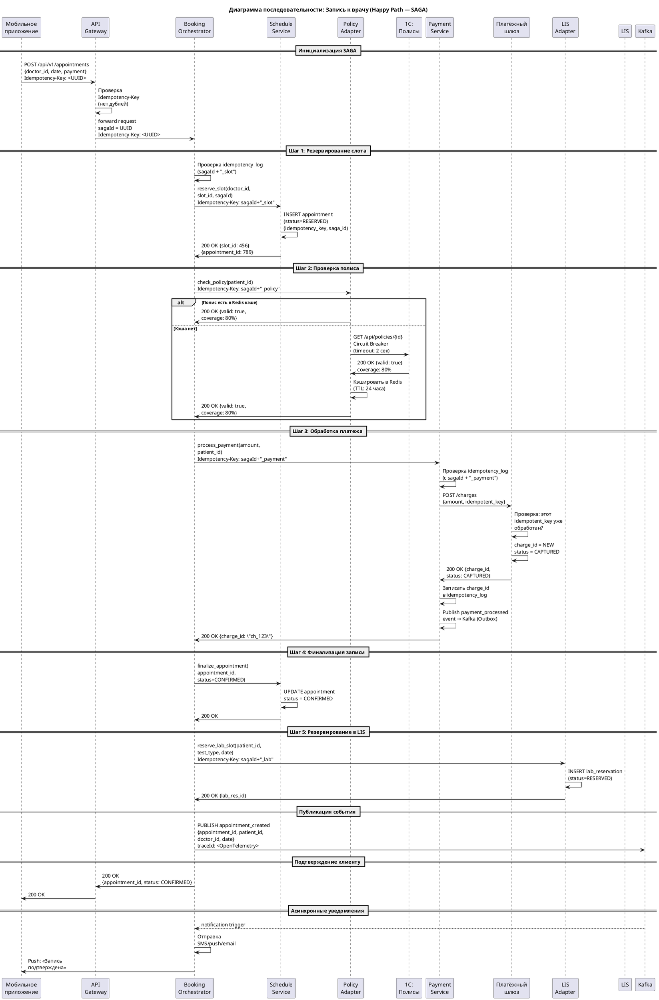

# Задание 3.2. Автоматизация бизнес-операции «Запись к врачу с оплатой и резервированием сдачи анализов»

## 1. Диаграмма последовательности (Happy Path — UML Sequence Diagram)



---

## 2. Обоснование выбора типа SAGA

### Выбранный тип: **Orchestration SAGA** (оркестратор-ориентированный)

| Критерий | Choreography SAGA | Orchestration SAGA | Обоснование выбора |
|----------|-------------------|-------------------|-------------------|
| **Явный порядок шагов** | Неявный (через события) | Явный (координатор) | Бизнес-процесс имеет жёсткую зависимость: слот должен быть зарезервирован ДО оплаты, оплата ДО финализации. Choreography не обеспечивает детерминированный порядок. |
| **Контроль над потоком** | Слабый (каждый компонент знает только следующие события) | Сильный (Orchestrator управляет всеми шагами) | Сценарий включает 5 шагов (резервирование, проверка полиса, оплата, финализация, LIS) с критическими зависимостями. |
| **Компенсирующие транзакции** | Распределённые по системам (сложно отследить) | Централизованные в Orchestrator | При ошибке оплаты необходимо: 1) отменить резервирование слота, 2) сделать refund. При ошибке LIS: 1) refund, 2) отмена слота. Порядок критичен. |
| **Отладка и мониторинг** | Сложный трекинг цепочки событий | Единая точка наблюдения (SAGA state) | Distributed tracing + SAGA state machine в одном месте. Критично для MTSLA 99.95%. |
| **Тестирование** | Требуется мокание всех событий | Mock только Orchestrator | Orchestration SAGA тестируется как единый компонент. |

**Вывод:** Orchestration SAGA — оптимальный выбор для данного сценария благодаря явному контролю порядка, централизованным компенсирующим транзакциям и прозрачности состояния.

---

## 3. Таблица компенсирующих транзакций

| # | Шаг сценария | Компенсирующее действие | Риск, который устраняется | Когда выполняется |
|---|--------------|------------------------|---------------------------|-------------------|
| **1** | **Резервирование слота** (Schedule Service) | **Отмена резервирования** | • Слот «зависает» в состоянии RESERVED<br>• Врач видит занятый слот, но запись не оплачена<br>• Пациент теряет возможность записи<br>**КРИТИЧНО:** потеря слота, репутационный ущерб | При сбое на шагах 2 (полис), 3 (оплата), 4 (финализация), 5 (LIS) |
| **2** | **Проверка полиса** (Policy Adapter) | **Нет компенсирующего действия** (операция read-only) | N/A — чтение не меняет состояние систем | N/A |
| **3** | **Обработка платежа** (Payment Service) | **Возврат платежа (Refund)** | • Деньги списаны, но услуга не оказана<br>• Финансовые потери пациента<br>• Юридические риски (PCI DSS)<br>**КРИТИЧНО:** финансовые потери, штрафы | При сбое шага 4 (финализация) или шага 5 (LIS) |
| **4** | **Финализация записи** (Schedule Service) | **Нет** (запись уже подтверждена, компенсация на шаге 1) | - | - |
| **5** | **Резервирование в LIS** (LIS Adapter) | **Отмена резервирования в LIS**: UPDATE lab_reservation SET status=CANCELLED | • Лаборатория ожидает пациента, но слот не зарезервирован<br>• Хаос в расписании лаборатории<br>• Пациент приходит, но анализ не готовы принять<br>**КРИТИЧНО:** неспособность оказать услугу | При недоступности LIS (timeout > 2 сек) |

### Порядок компенсации (при сбое на шаге 5):

```
Последовательность компенсации (в обратном порядке):
  Шаг 5: FAIL (LIS timeout)
    → Компенсация Шаг 3: Возврат платежа 
    → Компенсация Шаг 1: Отмена резервирования

Последовательность компенсации (при сбое на шаге 3):
  Шаг 3: FAIL (payment decline)
    → Компенсация Шаг 1: Отмена резервирования
  (Шаг 3 не списал деньги — refund не нужен)
```

---

## 4. Механизм обеспечения идемпотентности

Для полного исключения дублирования записей и повторных списаний средств, реализован механизм обеспечения идемпотентности:

1. **Генерация ключа идемпотентности на клиенте**:
   - Мобильное приложение перед отправкой запроса на запись генерирует уникальный идентификатор `X-Idempotency-Key`.
   - При повторной отправке запроса клиент передаёт тот же самый `X-Idempotency-Key` и дублирующей записи не возникает.

2. **Проверка и блокировка на уровне API Gateway / SAGA Orchestrator**:
   * При получении запроса сервис выполняет атомарную операцию в распределённом кэше (Redis):  
     `SET idempotency:<user_id>:<key> "IN_PROGRESS" NX EX 86400` (TTL = 24 часа).
   * **Если ключ новый (`NX` успешен)**: запускается выполнение SAGA-оркестрации.
   * **Если ключ уже со статусом `"IN_PROGRESS"`**: клиенту мгновенно возвращается ответ `409 Conflict` (или `425 Too Early`) с сообщением «Запрос уже обрабатывается, пожалуйста, подождите».
   * **Если ключ уже со статусом `"COMPLETED"`**: сервис извлекает из Redis сохранённый ранее ответ (Response Body, статус `201 Created` и заголовки) и возвращает его клиенту **без повторного выполнения бизнес-логики и списаний**.


### Проблемы без идемпотентности
• Повторный POST /appointments → двойная запись к врачу (SD-003)
• Retry платежа → двойное списание денег (SD-009, INT-001)
• Сеть упала после оплаты, но до ответа → SAGA перезапущена → повторная обработка

### Idempotency Keys на каждом шаге SAGA
#### Механизм
Каждый шаг SAGA использует уникальный `idempotency_key`, сформированный по правилу: idempotency_key = sagaId + "_<operation_name>"

| Шаг | Idempotency Key | Хранилище | TTL |
|-----|-----------------|-----------|-----|
| 1. Резервирование слота | `sagaId + "_slot"` | Schedule Service PostgreSQL | 24 часа |
| 2. Проверка полиса | `sagaId + "_policy"` | Redis (read-only) | 1 час |
| 3. Обработка платежа | `sagaId + "_payment"` | Payment Service PostgreSQL | 72 часа |
| 4. Финализация | Не требуется (запись уже зарезервирована) | — | — |
| 5. Резервирование LIS | `sagaId + "_lab"` | LIS Adapter PostgreSQL | 24 часа |


